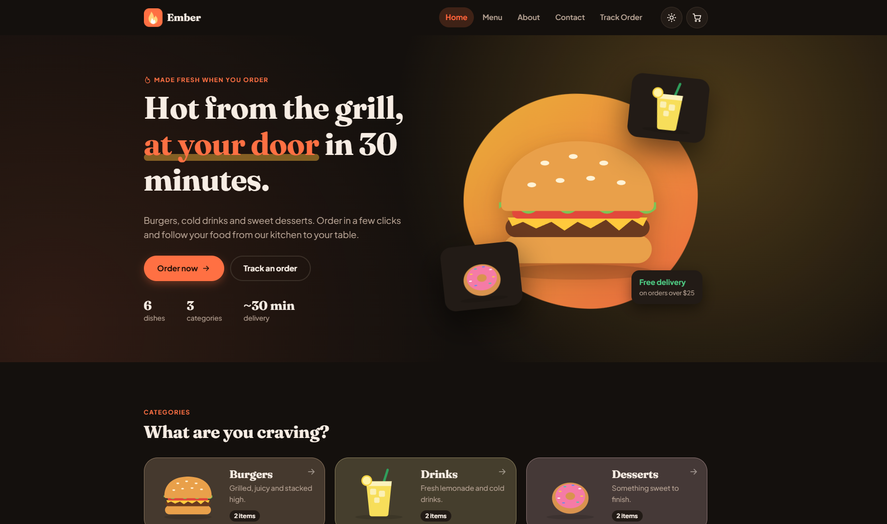
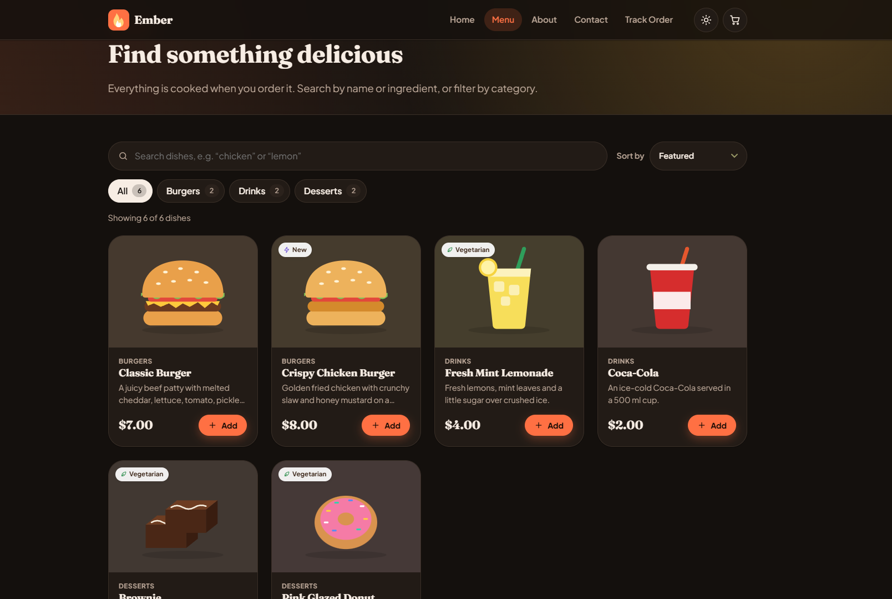
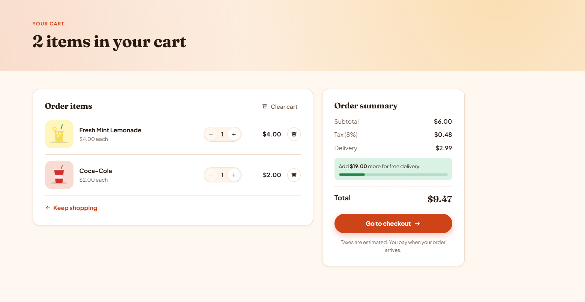
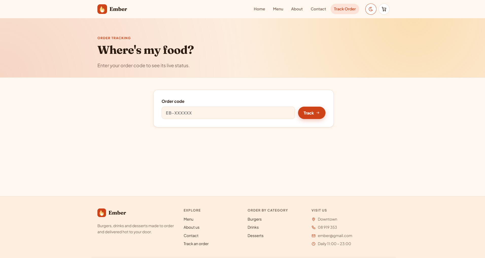
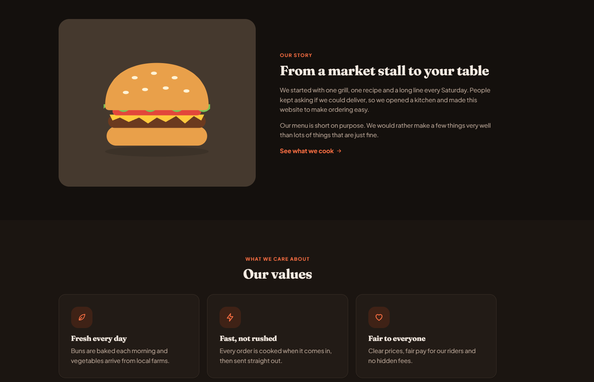
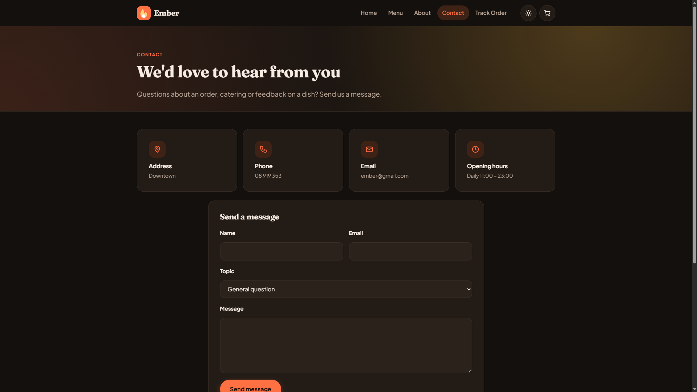

# Ember – Restaurant Ordering System

**Live site:** https://GGSmiley4.github.io/ember-restaurant/



## Project Description

For this project I made **Ember**, a restaurant ordering website built with React. You can look at the menu, add food to a cart, place an order and then track it until it's delivered.

The menu has 6 items: two burgers, two drinks and two desserts.

**What it can do:**

- Show the menu as cards with a picture, name, price and category
- Search for a dish or filter by category
- Add and remove items in the cart and change quantities. It works out the subtotal, tax and total for you.
- Fill in a checkout form with your name, phone, address and payment type (cash or card, no real payment). It checks that everything is filled in correctly.
- Track the order with a status bar: Received → Preparing → On the way → Delivered
- Switch between light mode and dark mode

The website works on both computers and phones. There's no backend, so the cart and orders are saved in the browser.

**Built with:** React (Create React App), React Router and CSS.

## Setup Instructions

1. Install [Node.js](https://nodejs.org/) if you don't have it.

2. Download the project:

   ```bash
   git clone https://github.com/GGSmiley4/ember-restaurant.git
   ```

3. Go into the project folder:

   ```bash
   cd ember-restaurant
   ```

4. Install the packages:

   ```bash
   npm install
   ```

5. Start the website:

   ```bash
   npm start
   ```

6. Open **http://localhost:3000** in your browser.

## Screenshots

### Home


### Menu


### Cart


### Track Order


### About


### Contact

